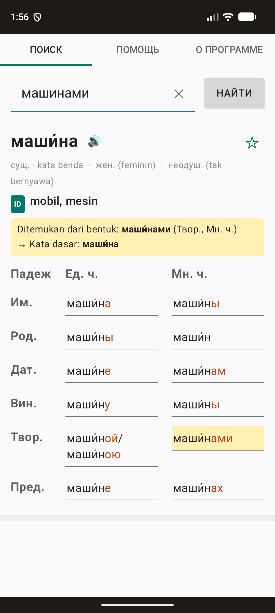
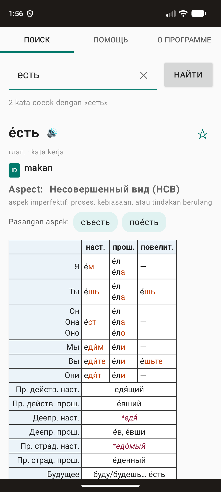
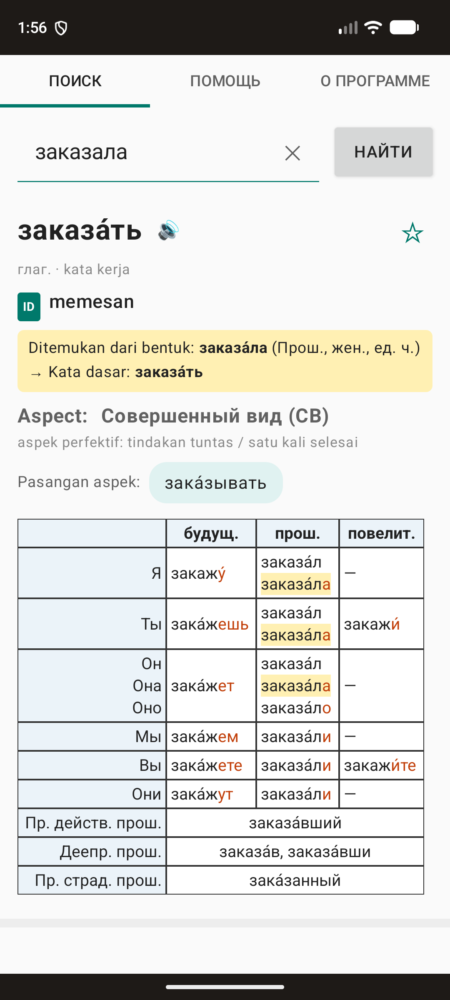
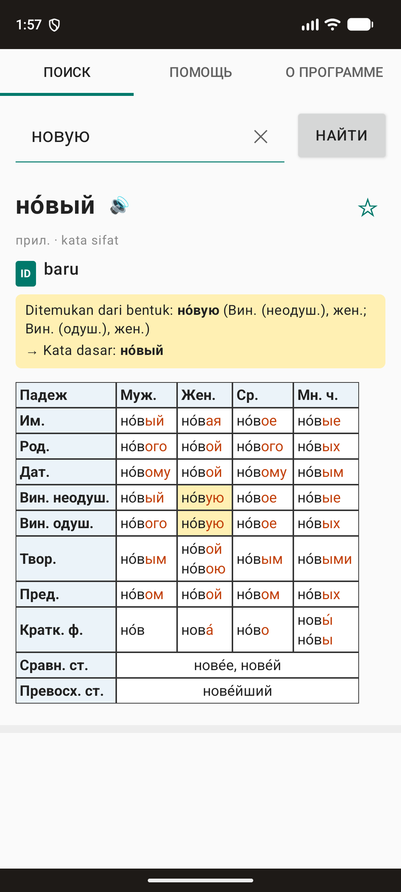
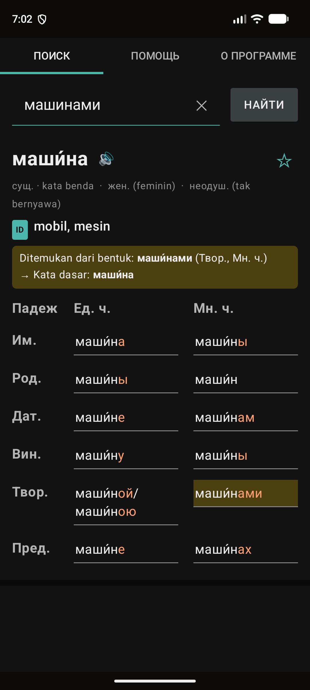
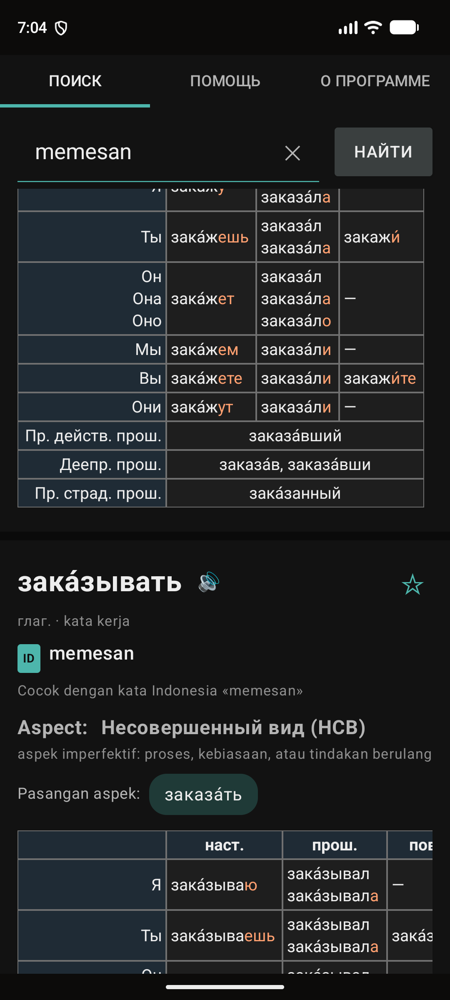
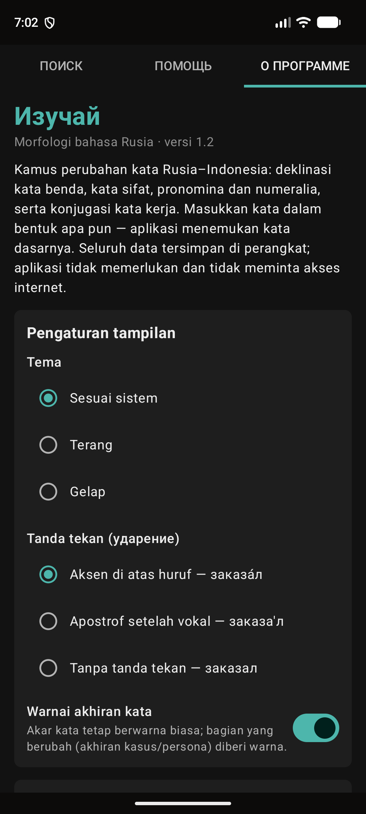

# Изучай — Morfologi Bahasa Rusia (offline)

Aplikasi Android untuk mempelajari **perubahan kata bahasa Rusia**: deklinasi kata benda, kata sifat,
pronomina, dan numeralia, serta konjugasi kata kerja — lengkap dengan tanda tekan (ударение) dan
terjemahan bahasa Indonesia. Bekerja **100% tanpa internet**.

Ketik kata dalam **bentuk apa pun** (`машинами`, `заказала`, `ели`) atau dalam **bahasa Indonesia**
(`mobil`, `makan`, `memesan`); aplikasi menemukan kata dasarnya dan menampilkan seluruh tabel perubahannya.

## Unduh & pasang

**[⬇ Unduh APK — izucai-v1.2.apk (22 MB)](https://github.com/aelgeaer/izucai/releases/latest)**
(atau langsung: [release/izucai-v1.2.apk](https://github.com/aelgeaer/izucai/raw/main/release/izucai-v1.2.apk))

**Versi 1.2** — kosakata untuk mahasiswa Indonesia di ITMO, dari kurs persiapan bahasa hingga tahun ketiga:
lema berterjemahan Indonesia naik dari 3.247 menjadi **5.827**. Mencakup administrasi kampus
(деканат, сессия, зачёт, пересдача, зачётка, стипендия), pelajaran bahasa Rusia, IT & pemrograman,
AI/data, keamanan informasi, matematika, fisika, optik & fotonika, elektronika, kimia/bioteknologi,
serta kehidupan di Sankt-Peterburg (registrasi migrasi, bank, asrama, transportasi, kesehatan, makanan halal,
musim dingin). Kata modern yang belum ada di Wiktionary bahasa Inggris (хакатон, фреймворк, конспектировать, …)
kini diambil dari Wiktionary bahasa Rusia.

Versi 1.1: homonim berejaan sama (mis. покупа́ть "membeli" / покупа́ть "memandikan sebentar") mendapat
terjemahan masing-masing. Setiap versi bisa dipasang di atas versi sebelumnya tanpa mencopotnya.

1. Buka tautan di atas dari ponsel Android (Android 7.0 atau lebih baru).
2. Buka berkas yang terunduh, lalu izinkan "pasang dari sumber ini" bila diminta.
3. Peluncuran pertama memakan beberapa detik karena basis data (±60 MB) disalin ke penyimpanan aplikasi.

Aplikasi tidak meminta izin apa pun, termasuk akses internet. Untuk pelafalan, perangkat perlu memiliki
suara bahasa Rusia di *Setelan → Text-to-speech* (bawaan pada kebanyakan ponsel).

## Tampilan

| Kata benda | Homonim `есть` | Kata kerja | Kata sifat |
|:--:|:--:|:--:|:--:|
|  |  |  |  |

Mode gelap:

| Kata benda | Kata kerja | Pengaturan tema |
|:--:|:--:|:--:|
|  |  |  |

## Fitur

- **Pencarian dari bentuk apa pun** — `машинами` → `маши́на`, dengan keterangan "Ditemukan dari bentuk:
  маши́нами (Твор., Мн. ч.)" dan sel yang bersangkutan disorot di tabel.
- **Dua bahasa** — kata Rusia (Sirilik) atau Indonesia (Latin) dideteksi otomatis.
- **Homonim** — satu ejaan bisa milik beberapa kata; `есть` menampilkan tabel *makan* sekaligus tabel
  lengkap `быть`; `ели` menampilkan `есть` dan `ель`.
- **Normalisasi masukan** — huruf besar/kecil, tanda tekan, dan `ё`/`е` tidak perlu diketik persis.
- **Saran saat mengetik** mulai dari 2 huruf, untuk kedua bahasa.
- **Tabel sesuai kelas kata**
  - kata benda: 6 kasus × tunggal/jamak (plus kasus lokatif/partitif/vokatif bila ada);
  - kata kerja: kala kini/depan, lampau, imperatif, partisip & gerund, aspek НСВ/СВ dan pasangan aspeknya;
  - kata sifat: 6 kasus × 3 gender + jamak, bentuk pendek, komparatif, superlatif;
  - bentuk jarang/usang ditandai `*` berwarna merah tua.
- **Pelafalan offline** — ketuk bentuk kata mana pun untuk mendengarnya dan melihat keterangan gramatikalnya.
- **Riwayat & kata tersimpan** (☆) untuk mengulang hafalan.
- **Tab ПОМОЩЬ** — penjelasan 6 kasus beserta kata tanya dan contoh, serta arti semua singkatan tabel.
- **Tab О ПРОГРАММЕ** — statistik basis data dan pengaturan: **tema (sesuai sistem / terang / gelap)**,
  gaya tanda tekan (`заказа́л` / `заказа'л` /
  tanpa tanda) dan pewarnaan akhiran kata.
- **Mode gelap** — mengikuti pengaturan sistem secara otomatis, atau dipaksa terang/gelap dari tab
  О ПРОГРАММЕ. Pilihan tersimpan di perangkat; kontras kedua tema diuji otomatis agar teks tetap terbaca.

## Isi basis data

| | Jumlah |
|---|---:|
| Kata dasar (lema) | 25.827 |
| — kata benda / kata kerja / kata sifat | 13.975 / 7.188 / 4.534 |
| — pronomina / numeralia | 78 / 52 |
| Bentuk kata yang dikenali | 325.351 |
| Lema berterjemahan Indonesia (kamus kurasi) | 5.827 |

Lema di luar kamus kurasi tetap memiliki tabel perubahan lengkap; artinya ditampilkan dalam bahasa Inggris
(label **EN**). Terjemahan Indonesia ditambah lewat berkas di `data_pipeline/translations/`:

```
машина = mobil, mesin                      # bentuk dasar
за́мок = kastil, puri                       # tanda tekan membedakan homograf
покупать [to buy] = membeli                # [kata kunci arti Inggris] membedakan homonim
покупать [to bathe] = memandikan (sebentar)
```

Bila satu ejaan dimiliki beberapa lema dan baris kamus tidak memakai penanda arti, terjemahan hanya diberikan
ke lema yang paling sering dipakai. Kata kunci dicocokkan dengan arti Wiktionary (`translations_en`).

## Struktur proyek

```
data_pipeline/            Pembuat basis data (Python, hanya pustaka standar)
  download_sources.py     Unduh dump Wiktionary Inggris & Rusia (Kaikki) + daftar frekuensi
  build_db.py             Urai → pilih lema → tulis russian_morphology.db
  kaikki_parser.py        Entri Wiktionary → paradigm_json
  ruwikt.py               Adaptor ru.wiktionary untuk kata kurasi yang tidak ada di en.wiktionary
  special_cases.py        быть, pronomina, dan koreksi yang ditulis tangan
  translations/*.txt      Kamus kurasi Rusia → Indonesia  (лемма = terjemahan, ...)
  verify_db.py            Pemeriksaan SQL atas basis data hasil
app/                      Aplikasi Android (Kotlin, Jetpack Compose, MVVM)
  src/main/assets/russian_morphology.db
  src/main/java/com/izucai/morphology/
    data/                 Normalisasi teks, model paradigma, DAO, repository pencarian
    ui/                   ViewModel, layar pencarian/bantuan/tentang, tabel paradigma
  src/test/               Unit test JVM (menguji SQL aplikasi terhadap .db asli lewat JDBC)
  src/androidTest/        Uji instrumentasi alur pencarian (Compose UI test)
release/izucai-v1.2.apk   APK siap pasang
```

Skema SQLite: `lemmas` (kata dasar + `paradigm_json`), `word_forms` (indeks terbalik bentuk → lema,
berindeks pada `form_clean`), `id_search_index` (kata Indonesia → lema), `meta`.

## Membangun sendiri

Prasyarat: JDK 17+, Android SDK (platform 36), Python 3.10+.

```bash
# 1. (opsional) bangun ulang basis data — hasilnya otomatis disalin ke app/src/main/assets/
python data_pipeline/download_sources.py      # ±120 MB, sekali saja
python data_pipeline/build_db.py              # --extended N mengatur jumlah lema di luar kamus kurasi
python data_pipeline/verify_db.py

# 2. uji & bangun aplikasi
./gradlew testDebugUnitTest                   # 28 unit test
./gradlew assembleDebug assembleRelease       # APK di app/build/outputs/apk/{debug,release}/

# 3. uji instrumentasi (perlu emulator/perangkat tersambung)
./gradlew installDebug installDebugAndroidTest
adb shell am instrument -w com.izucai.morphology.test/androidx.test.runner.AndroidJUnitRunner
```

Catatan: APK release ditandatangani dengan kunci debug agar bisa langsung dipasang. Untuk distribusi lewat
Play Store, ganti `signingConfig` di `app/build.gradle.kts` dengan keystore milik sendiri.

## Sumber data & lisensi

- Tabel deklinasi/konjugasi dan tanda tekan: [Wiktionary](https://en.wiktionary.org) melalui ekstraksi
  [Kaikki.org](https://kaikki.org/dictionary/Russian/) — CC BY-SA 4.0.
- Kata yang belum ada di Wiktionary bahasa Inggris: [Wiktionary bahasa Rusia](https://ru.wiktionary.org)
  melalui [Kaikki.org](https://kaikki.org/ruwiktionary/) — CC BY-SA 4.0.
- Urutan frekuensi kata: [FrequencyWords](https://github.com/hermitdave/FrequencyWords) (korpus
  OpenSubtitles 2018) — CC BY-SA 4.0.
- Terjemahan Indonesia: kamus kurasi proyek ini.

Karena memuat data turunan Wiktionary, berkas `russian_morphology.db` tunduk pada CC BY-SA 4.0.
